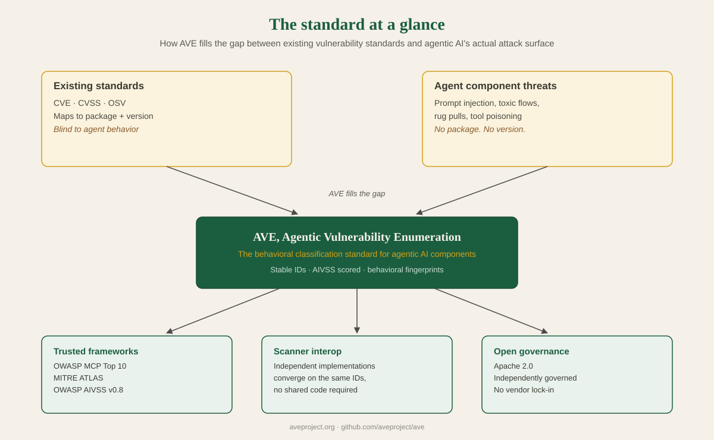

<div align="center">


<br/>
<br/>

**The open behavioral classification standard for agentic AI components.**

Stable IDs, AIVSS scores, and behavioral fingerprints for every way a skill file,
MCP server, system prompt, or agent plugin can be weaponized — scored consistently,
mapped to the frameworks security teams already report against.

[](records/)
[](schema/ave-record-2.0.0.schema.json)
[](https://aivss.owasp.org)
[](https://owasp.org)
[](https://atlas.mitre.org)
[](docs/specs/ave-in-sarif.md)
[](LICENSE)

[](https://github.com/aveproject/ave/actions/workflows/tests.yml)
[](https://github.com/aveproject/ave/actions/workflows/codeql.yml)
[](https://github.com/aveproject/ave/actions/workflows/dependency-review.yml)
[](https://github.com/aveproject/ave/actions/workflows/secret-scan.yml)
[](https://scorecard.dev/viewer/?uri=github.com/aveproject/ave)
[](SECURITY.md)
[](CODE_OF_CONDUCT.md)

[Registry](https://aveproject.org/registry.html) · [Schema](https://aveproject.org/schema.html) · [Crosswalks](https://aveproject.org/crosswalks.html) · [Architecture](https://aveproject.org/architecture.html) · [Scoring](https://aveproject.org/scoring.html) · [Versions](https://aveproject.org/versions.html) · [API](https://api.aveproject.org/docs) · [Implementer guide](https://aveproject.org/implementer-guide.html)

</div>

---

## What is AVE?

Skill files, MCP server manifests, and system prompts are executable
instructions, not documentation. Any process that loads them runs them.
There is no compiler, no type checker, no sandbox. The runtime is an LLM
that reads natural language and acts on it.

Existing vulnerability standards were built for conventional software.
CVE identifies flaws in a specific product and version. OSV maps them to
package and version ranges. Neither can describe a prompt injection hidden
in an MCP tool description — there is no package, no version, no vulnerable
dependency. The danger is in what the component *does*, not what it imports.

**AVE fills that gap.** It assigns stable identifiers to distinct behavioral
classes in agentic AI, scores them with OWASP AIVSS v0.8, and maps every
record to OWASP MCP Top 10 and MITRE ATLAS so findings land in frameworks
defenders already use.

AVE is a standard, not a product. The `bawbel-scanner` implements it as the
reference implementation. Any tool can map to it — see the
[implementer guide](docs/specs/ave-implementer-guide.md) for how.

### What AVE is not

AVE is a naming and classification standard. It assigns stable IDs to
behavioral vulnerability classes and describes how to detect them. It
is not a runtime enforcement mechanism, and an AVE ID on its own stops
nothing. Enforcement requires a separate policy or gating layer that
consumes AVE's records, the same relationship CWE has to an actual
static analyzer, or a CVE has to a patch management system.

```
Your CI pipeline scans dependencies for known package vulnerabilities.
It does not scan your SKILL.md for prompt injection.
AVE fixes that.
```

<p align="center">
  
</p>

---

## How it works

AVE keeps three things apart on purpose.

| | What it is | Where it lives |
|---|---|---|
| **The standard** | Records, each defining one behavioral class; the schema they validate against; two conformance fixtures per record; crosswalks to other frameworks and tools | this repository |
| **Implementations** | Scanners, gateways and dashboards that detect a class and report it under its `ave_id`. Their detection rules are their own | their own repositories |
| **Consumers** | CI gates, SARIF viewers, dashboards and ticketing: anything that reads findings or records and keys on `ave_id` | your systems |

Definitions here, detections there. An AVE record is not a detection rule, and an `ave_id` on its own stops nothing.

**A record is a class. A finding is one detection of it.**

| AVE record (this repository) | Finding (an implementation) |
|---|---|
| a behavioral class, written once by a person | one detection, produced by every scan |
| `behavioral_fingerprint`, `severity`, `aivss`, framework mappings, indicators, remediation | the `ave_id`, plus where and why it fired |
| may declare a `confidence_baseline` | assigns the actual `confidence` |
| never carries a `confidence` | always carries one |

**A record's life**

1. **Propose.** A researcher finds an agentic behavior no record covers, with a citable primary source, and opens an issue. A new `ave_id` is only for a genuinely distinct behavioral class.
2. **Write.** The record (fingerprint, indicators, remediation, AIVSS score, framework mappings) and two fixtures: one text a conforming implementation must flag, one it must not.
3. **Validate.** CI checks the record against the schema, recomputes its score, and requires both fixtures. A maintainer reviews.
4. **Publish.** `dist/ave-records-latest.json` moves, and the [API](#the-api) follows within about 15 minutes. The next [catalog release](#releases-and-pinning) freezes a copy: tagged, checksummed and attested.
5. **Implement.** A tool maps its own rules to the `ave_id`. Its findings carry the id, and each run records the catalog release it scanned against.
6. **Consume.** CI gates, SARIF viewers and dashboards deduplicate and report on the id, across tools.

---

## Using AVE

```bash
curl -s https://api.aveproject.org/v1/records/AVE-2026-00046 \
  | jq '{ave_id, title, severity, score: .aivss.aivss_score, owasp_mcp}'
```

```json
{
  "ave_id": "AVE-2026-00046",
  "title": "MCP tool hook hijacking - redirect tool execution to attacker-controlled callback",
  "severity": "CRITICAL",
  "score": 10,
  "owasp_mcp": ["MCP03", "MCP06"]
}
```

| I want to | Do this |
|---|---|
| Read what a class is and how it is scored | Open it in the [registry](https://aveproject.org/registry.html), or read `records/AVE-YYYY-NNNNN.json` |
| Look one up from a script, IDE or chat | [Call the API](#the-api) |
| Filter or analyze the whole catalog | [Download it and query it](#filter-the-whole-catalog) with `jq` or any JSON tool |
| Gate CI on a fixed set of records | [Pin a catalog release](#releases-and-pinning) and verify its checksums |
| Scan a skill file or MCP server | Run a tool that implements AVE, such as the [reference implementation](#scan-with-the-reference-implementation) |
| Add AVE ids to my own tool | Follow the [implementer guide](docs/specs/ave-implementer-guide.md) and the [AVE-in-SARIF convention](docs/specs/ave-in-sarif.md) |
| Compare AVE with another framework or scanner | Read the [crosswalks](#framework-crosswalks) |
| Propose a new behavioral class | [Add a record](#adding-a-new-ave-record) |

### Filter the whole catalog

`dist/ave-records-latest.json` is every published record as one JSON array.

```bash
curl -sL https://raw.githubusercontent.com/aveproject/ave/main/dist/ave-records-latest.json -o ave-records.json

# every active CRITICAL and HIGH record
jq -r '.[] | select(.status == "active") | select(.severity == "CRITICAL" or .severity == "HIGH")
       | "\(.ave_id)  \(.aivss.aivss_score)  \(.title)"' ave-records.json

# active records mapped to one OWASP MCP Top 10 category
jq -r '.[] | select(.status == "active") | select(.owasp_mcp | index("MCP04")) | .ave_id' ave-records.json
```

Filter on `status`: a record that is `deprecated`, `merged` or `rejected` stays in the file, and a consumer
must treat anything other than `active` as not active. The `latest` file changes with every change to
`records/`; for anything that must be reproducible, pin a [catalog release](#releases-and-pinning) instead.

---

## The API

[`api.aveproject.org`](https://api.aveproject.org/docs) is a read-only reference API over the published
records: no authentication and no write endpoints. The interactive reference is at
[api.aveproject.org/docs](https://api.aveproject.org/docs), the source and full contract are in
[aveproject/ave-api](https://github.com/aveproject/ave-api), and how to use it from a tool is in the
[implementer guide](docs/specs/ave-implementer-guide.md#the-api).

| Method | Path | Returns |
|---|---|---|
| GET | `/v1/records` | every record, deprecated ones included with their `status` |
| GET | `/v1/records/{ave_id}` | one record |
| GET | `/v1/records/{ave_id}/mitigation` | the record's vendor-neutral `mitigation` object only |
| GET | `/v1/search?q=...` | records whose title, description, attack class or fingerprint contain the text |
| GET | `/v1/releases` | the catalog releases, and which of them can be pinned |

```bash
curl -s "https://api.aveproject.org/v1/search?q=hook" | jq -r '.[].ave_id'
curl -s "https://api.aveproject.org/v1/records/AVE-2026-00046?release=v1.2.0" | jq .schema_version
```

- `?release=vX.Y.Z` reads a fixed catalog release instead of the latest data. Releases from `v1.2.0` can be pinned.
- Every data response names its source in the `AVE-Catalog`, `AVE-Records-SHA256` and `AVE-Schema-Version` headers.
- `/v1` is the versioned contract. The unversioned paths are aliases with identical bodies.
- A `deprecated`, `merged` or `rejected` record is served with its `status`. Only an id that was never published is a `404`.
- Limits: 60 requests a minute per IP for each path, from a single instance that scales to zero, so the first
  request after a quiet spell is slow. Use the API for lookups and links. A scanner that resolves ids on every
  finding should read a pinned release locally.

Anyone can run their own instance, and nothing about AVE depends on the hosted one staying available.

---

## Independent validation

AVE's ID scheme has been tested by people who didn't build it, not
just used by people who did.

Eight independent tools, cfgaudit, ClawScan, nova-proximity, Ramparts,
Semia, SkillSpector (NVIDIA), skill-security-scanner, and skillsentry,
none of them sharing code with AVE or with each other, built
crosswalks against AVE's records on their own initiative, unprompted.
In each case the comparison went beyond matching category labels:
mechanism-level correspondence was checked field by field, real
trigger conditions against real behavioral fingerprints, and dozens of
findings converged on the identical AVE ID independently.

One of those crosswalks (Ramparts) also surfaced a real methodological
lesson: two independently-drafted readings of the same still-
unratified OWASP MCP Top 10 numbered their own categories differently,
confirmed and documented so future crosswalks match by category
meaning, not by tag number.

Separately, an external maintainer caught a real attribution error in
two published AVE records, corrected the underlying process
documentation, not just the two records, credited in
[CONTRIBUTORS.md](CONTRIBUTORS.md).

89 records. 8 independent crosswalks. See
[crosswalks/](crosswalks/) for the full mappings, and
[docs/writeups/](docs/writeups/) for full technical write-ups on
individual records.

---

## Stats

| | |
|---|---|
| Total records | 89 |
| Schema version | 2.0.0 |
| AIVSS spec | v0.8 |
| CRITICAL (>= 9.0) | 40 |
| HIGH (7.0-8.9) | 41 |
| MEDIUM (4.0-6.9) | 8 |
| LOW (< 4.0) | 0 |
| Framework: OWASP MCP Top 10 | all records |
| Framework: MITRE ATLAS | where applicable |
| Framework: OWASP Agentic AI Top 10 | where applicable |
| Framework: NIST AI RMF | where applicable |

---

## AIVSS Scoring

Every record is scored with [OWASP AIVSS v0.8](https://aivss.owasp.org), using the equation in sections 3.3 to 3.5
of its specification:

```
AARS  = (10 - CVSS_Base) x (Factor_Sum / 10) x ThM
AIVSS = (CVSS_Base + AARS) x Mitigation_Factor
```

`CVSS_Base` is a CVSS v4.0 base score (`aivss.cvss_base`). `Factor_Sum` is the sum of ten Agentic Risk Amplification
Factors (AARF), each scored 0.0, 0.5 or 1.0 and stored in `aivss.aarf`. `AARS`, the agentic uplift, is the part of
the distance from the CVSS base to 10 that the factors bridge, and `aivss.aars` records it. The score is rounded half
up to one decimal. AVE scores a behavioral class, the way OWASP's own case studies score its Core Risks (section
3.6), so a factor describes the typical agentic deployment the class acts in. How each factor is judged is in
[references/aivss-scoring.md](references/aivss-scoring.md).

| # | Factor | AVE key | What it measures |
|---|---|---|---|
| 1 | **Autonomy** | `autonomy` | Executes actions without human verification |
| 2 | **Tools** | `tool_use` | Breadth and privilege of the external tools and APIs the agent can use |
| 3 | **Language** | `natural_language_input` | Reliance on unstructured natural language for goals and instructions |
| 4 | **Context** | `context` | Environmental signals or broad data context drive decisions |
| 5 | **Non-Determinism** | `non_determinism` | Variance in output or action for identical inputs |
| 6 | **Opacity** | `opacity` | Lack of visibility into, or ability to audit, decision logic |
| 7 | **Persistence** | `persistent_memory` | Retains memory or state across sessions |
| 8 | **Identity** | `dynamic_identity` | Assumes different roles or permissions at runtime |
| 9 | **Multi-Agent** | `multi_agent` | Coordinates with, or depends on, other autonomous agents |
| 10 | **Self-Mod** | `self_modification` | Can alter its own code, prompts or tool configuration |

**Severity bands:**

| Band | AIVSS | Meaning |
|---|---|---|
| CRITICAL | >= 9.0 | Immediate exploitation, full agent compromise |
| HIGH | 7.0-8.9 | Significant data loss or privilege escalation |
| MEDIUM | 4.0-6.9 | Meaningful risk requiring review |
| LOW | < 4.0 | Limited impact or requires chaining |

**ThM (Threat Multiplier) valid values:** `0.5` (Unreported, theoretical) · `0.97` (Proof-of-Concept) · `1.0` (Attacked, in the wild)

**Mitigation_Factor valid values:** `1.0` (no or weak mitigation) · `0.83` (partial) · `0.67` (strong, validated)

**Worked example, AVE-2026-00001 (Metamorphic Payload):**

```
Factors:
  autonomy=1.0  tool_use=1.0  natural_language_input=1.0  context=0.5  non_determinism=1.0
  opacity=1.0  persistent_memory=0.5  dynamic_identity=0.0  multi_agent=0.5  self_modification=1.0

Factor_Sum = 7.5
CVSS_Base = 8.5   ThM = 1.0 (Attacked)   Mitigation_Factor = 1.0

AARS  = (10 - 8.5) x (7.5 / 10) x 1.0 = 1.125
AIVSS = (8.5 + 1.125) x 1.0 = 9.625  ->  9.6  CRITICAL
```

Before you rely on a score:

- **The CVSS base is the floor.** The equation adds the uplift to the CVSS base score, so a record never scores
  below its `cvss_base` times its Mitigation_Factor. A low score needs a low base.
- **Rounding.** Half up, as the OWASP document says: 9.625 is 9.6 and 9.35 is 9.4. `scripts/validate_records.py`
  works in exact decimal arithmetic, so no result falls on the wrong side of a floating-point representation.
- **Checking.** `scripts/validate_records.py` recomputes `aivss.aars` from the base, the factors and ThM, and the
  score from `aars` and the Mitigation_Factor, for every record; it requires the top-level `aivss_score` to match and
  `severity` to be the band the score falls in. Its test reproduces the ten worked examples in OWASP's document.
- **Not a confidence.** AIVSS says how bad a class is if it fires. How sure a scanner is that it fired is
  `confidence`, assigned per detection on the finding and never stored in a record
  ([record versus finding](#how-it-works)).
- **Scores can move, ids do not.** A re-score is a correction to a record, recorded in its `revisions`
  ([Stability](#stability)). Pin a catalog release if a score must not change under you.

The [Scoring page](https://aveproject.org/scoring.html) shows the factor
definitions, how the published scores are spread, and worked examples built
from the records themselves.

---

## Stability

What you can rely on, and where each promise is defined. They are commitments the project holds itself to;
the ones a machine can check are checked in CI.

| You depend on | What is promised | Defined in |
|---|---|---|
| An `ave_id` | Never renumbered, reused or deleted once published. A record found wrong keeps its id and changes `status` instead. | [ID stability](docs/specs/scaling-and-governance.md#5-id-stability-policy) |
| What a record says | It can be corrected as understanding improves (description, remediation, severity, score), but the id keeps pointing at the same behavioral class. A change to `severity`, `status` or the derived `verification_basis` is recorded in the record's append-only `revisions`, and CI fails a change that leaves it out. | [ID stability](docs/specs/scaling-and-governance.md#5-id-stability-policy), [CONTRIBUTING.md](CONTRIBUTING.md#recording-a-change-revisions) |
| A record's `status` | `active`, `deprecated`, `merged` (with `merged_into`) or `rejected` (with `rejection_reason`). Treat anything other than `active` as not active, and expect new values. | [Deprecation policy](docs/specs/scaling-and-governance.md#3-deprecation-policy) |
| The schema | A minor version never removes or renames a field, changes its meaning, or narrows a type or enum; anything else is a major version. Each published `schema/ave-record-X.Y.Z.schema.json` and `dist/ave-records-vX.Y.Z.json` is frozen, and a test fails if one changes. Every record validates against the version it declares. | [Schema versioning policy](docs/specs/scaling-and-governance.md#2-schema-versioning-policy) |
| A catalog release | A GitHub Release `vX.Y.Z` never changes, and carries checksums and a build provenance attestation. A patch release corrects existing records, a minor one adds records or takes a minor schema, a major one takes a major schema or changes what an id means. At most monthly unless a correction is urgent. | [Catalog releases](docs/specs/scaling-and-governance.md#6-catalog-releases), [Releases and pinning](#releases-and-pinning) |
| The API | `/v1` is the versioned contract and the unversioned paths stay as aliases. A pinned release (`?release=`) never changes. | [aveproject/ave-api](https://github.com/aveproject/ave-api#endpoints) |

**Scoring changed in schema 2.0.0.** AVE moved to the OWASP AIVSS v0.8 equation. That changed what `aivss.aars`
and `aivss.thm` mean and replaced two `aarf` factors, which makes it a major version, and every record was re-scored:
each one carries a `revisions` entry with its old and new score, and one more for any change of severity. Schema
1.3.0 and the catalog release v1.2.0 keep the earlier scores exactly as published; pin v1.2.0 to keep them.

What is not promised: the latest data (`dist/ave-records-latest.json`, or the API without `?release=`) changes
whenever the records do. For repeatable scans, pin a release.

---

## Trust, and how to check it

AVE is young, and a standard is only worth using if you can check it. Each row says what is verified and how
to verify it yourself.

| You want to know | What is checked | Check it yourself |
|---|---|---|
| A record is well formed and scored consistently | Every pull request validates every record against the schema version it declares and recomputes its `aars` and score. A failure fails the check. | `python scripts/validate_records.py` |
| The class is real and sourced | The schema requires at least one reference on every record, a pull request must link the primary source, and a maintainer reviews it. | the record's `references` |
| An implementation can test itself against it | Every record has a positive fixture a conforming implementation must flag and a negative one it must not. CI fails without both. | `tests/fixtures/AVE-YYYY-NNNNN_positive.md` and `_negative.md`; `python scripts/check_fixtures.py` |
| The framework mappings are anchored | Every framework a record maps to has a `framework_sources` entry saying which edition the mapping was made against, or that the edition is unknown. CI fails without it. | `python scripts/check_framework_sources.py --strict` |
| A record did not change under you | A change to `severity`, `status` or the derived basis is recorded in `revisions`, and git keeps every version. A released copy never changes. | `git log -p records/AVE-YYYY-NNNNN.json` |
| The files you downloaded are the ones published | Each catalog release carries SHA-256 checksums and a build provenance attestation. | the commands in [Releases and pinning](#releases-and-pinning) |
| Others have tested it | Eight independent tools built crosswalks against the records on their own initiative. | [Independent validation](#independent-validation), [`crosswalks/`](crosswalks/) |
| The repository itself is looked after | CodeQL, dependency review, secret scanning and OpenSSF Scorecard run on it. | the badges at the top |

What AVE does not claim: that it lists every agentic vulnerability. Records grow with research, not with
quotas, and a class with no record is a gap to report, not a clean bill of health. Nor does AVE enforce
anything; an `ave_id` stops nothing on its own ([what AVE is not](#what-ave-is-not)).

Found a mistake, or something AVE does not cover? [Open an issue](https://github.com/aveproject/ave/issues/new/choose):
a bug report for a wrong record, a schema change proposal, or a new record submission. To send a critical or
pre-disclosure finding privately, see [SECURITY.md](SECURITY.md).

---

## Record index

<details>
<summary><strong>89 records, click to expand</strong></summary>

| AVE ID | Title | AIVSS | Severity |
|---|---|---|---|
| [AVE-2026-00001](records/AVE-2026-00001.json) | Metamorphic Payload via External Config Fetch | 9.6 | CRITICAL |
| [AVE-2026-00002](records/AVE-2026-00002.json) | Tool Poisoning via Description Manipulation | 9.5 | CRITICAL |
| [AVE-2026-00003](records/AVE-2026-00003.json) | Data Exfiltration via Credential Theft | 9.2 | CRITICAL |
| [AVE-2026-00004](records/AVE-2026-00004.json) | Arbitrary Code Execution via Shell Pipe Injection | 7.9 | HIGH |
| [AVE-2026-00005](records/AVE-2026-00005.json) | Destructive Command Execution | 7.9 | HIGH |
| [AVE-2026-00006](records/AVE-2026-00006.json) | Cryptocurrency Drain via Wallet Access | 9.8 | CRITICAL |
| [AVE-2026-00007](records/AVE-2026-00007.json) | Goal Hijacking via Prompt Injection | 7.8 | HIGH |
| [AVE-2026-00008](records/AVE-2026-00008.json) | Persistence via Self-Replication | 9.1 | CRITICAL |
| [AVE-2026-00009](records/AVE-2026-00009.json) | Jailbreak via Safety Constraint Removal | 7.7 | HIGH |
| [AVE-2026-00010](records/AVE-2026-00010.json) | Hidden Instruction Concealment | 7.7 | HIGH |
| [AVE-2026-00011](records/AVE-2026-00011.json) | Dynamic Tool Call with Attacker Parameters | 7.6 | HIGH |
| [AVE-2026-00012](records/AVE-2026-00012.json) | Privilege Escalation via Permission Grant | 7.1 | HIGH |
| [AVE-2026-00013](records/AVE-2026-00013.json) | PII Exfiltration Pattern | 8.9 | HIGH |
| [AVE-2026-00014](records/AVE-2026-00014.json) | Social Engineering via Trust Escalation | 6.3 | MEDIUM |
| [AVE-2026-00015](records/AVE-2026-00015.json) | System Prompt Disclosure | 6.9 | MEDIUM |
| [AVE-2026-00016](records/AVE-2026-00016.json) | Indirect Prompt Injection via RAG Retrieval | 8.0 | HIGH |
| [AVE-2026-00017](records/AVE-2026-00017.json) | MCP Server Impersonation | 8.9 | HIGH |
| [AVE-2026-00018](records/AVE-2026-00018.json) | Tool Result Manipulation | 7.0 | HIGH |
| [AVE-2026-00019](records/AVE-2026-00019.json) | Agent Memory Poisoning | 8.9 | HIGH |
| [AVE-2026-00020](records/AVE-2026-00020.json) | Cross-Agent Injection via A2A Protocol | 9.3 | CRITICAL |
| [AVE-2026-00021](records/AVE-2026-00021.json) | Human-in-the-Loop Bypass | 7.5 | HIGH |
| [AVE-2026-00022](records/AVE-2026-00022.json) | Scope Creep via Undeclared Resource Access | 7.6 | HIGH |
| [AVE-2026-00023](records/AVE-2026-00023.json) | Context Window Manipulation | 7.9 | HIGH |
| [AVE-2026-00024](records/AVE-2026-00024.json) | Supply Chain: Binary Content Disguised as Skill | 9.2 | CRITICAL |
| [AVE-2026-00025](records/AVE-2026-00025.json) | Conversation History Injection | 7.2 | HIGH |
| [AVE-2026-00026](records/AVE-2026-00026.json) | Tool Output Exfiltration via Encoding | 9.5 | CRITICAL |
| [AVE-2026-00027](records/AVE-2026-00027.json) | Multi-Turn Persistence Attack | 8.9 | HIGH |
| [AVE-2026-00028](records/AVE-2026-00028.json) | File Content Injection | 7.8 | HIGH |
| [AVE-2026-00029](records/AVE-2026-00029.json) | Homoglyph and Unicode Obfuscation | 7.3 | HIGH |
| [AVE-2026-00030](records/AVE-2026-00030.json) | False Role Claim | 7.1 | HIGH |
| [AVE-2026-00031](records/AVE-2026-00031.json) | Feedback Loop Poisoning | 8.5 | HIGH |
| [AVE-2026-00032](records/AVE-2026-00032.json) | Internal Network Reconnaissance | 6.9 | MEDIUM |
| [AVE-2026-00033](records/AVE-2026-00033.json) | Unsafe Deserialization in Skill Context | 7.3 | HIGH |
| [AVE-2026-00034](records/AVE-2026-00034.json) | Dynamic Skill Import at Runtime | 9.4 | CRITICAL |
| [AVE-2026-00035](records/AVE-2026-00035.json) | Sensor and Environment Manipulation | 7.0 | HIGH |
| [AVE-2026-00036](records/AVE-2026-00036.json) | Lateral Movement via Agent Pivot | 9.2 | CRITICAL |
| [AVE-2026-00037](records/AVE-2026-00037.json) | Vision and Multimodal Injection | 8.7 | HIGH |
| [AVE-2026-00038](records/AVE-2026-00038.json) | Unbounded Tool Use | 7.6 | HIGH |
| [AVE-2026-00039](records/AVE-2026-00039.json) | Covert Exfiltration via Steganographic Channel | 8.8 | HIGH |
| [AVE-2026-00040](records/AVE-2026-00040.json) | Insecure Output Handling | 7.4 | HIGH |
| [AVE-2026-00041](records/AVE-2026-00041.json) | MCP Server-Card Injection | 9.8 | CRITICAL |
| [AVE-2026-00042](records/AVE-2026-00042.json) | REPL Code Mode Credential Exposure | 7.7 | HIGH |
| [AVE-2026-00043](records/AVE-2026-00043.json) | MCP App UI Injection | 7.5 | HIGH |
| [AVE-2026-00044](records/AVE-2026-00044.json) | Async Task Result Poisoning | 9.8 | CRITICAL |
| [AVE-2026-00045](records/AVE-2026-00045.json) | Cross-App-Access Escalation | 9.4 | CRITICAL |
| [AVE-2026-00046](records/AVE-2026-00046.json) | MCP Tool Hook Hijacking | 10.0 | CRITICAL |
| [AVE-2026-00047](records/AVE-2026-00047.json) | Hardcoded Credentials in Agent Component | 9.3 | CRITICAL |
| [AVE-2026-00048](records/AVE-2026-00048.json) | Unsafe Agent Delegation Chain | 9.7 | CRITICAL |
| [AVE-2026-00049](records/AVE-2026-00049.json) | HTTP Host Header Injection (BadHost) | 8.9 | HIGH |
| [AVE-2026-00050](records/AVE-2026-00050.json) | Parasitic Toolchain — Silent Tool Registration | 9.7 | CRITICAL |
| [AVE-2026-00051](records/AVE-2026-00051.json) | OAuth Discovery Rebinding | 9.8 | CRITICAL |
| [AVE-2026-00052](records/AVE-2026-00052.json) | MCP Tool Implementation Command Injection | 9.9 | CRITICAL |
| [AVE-2026-00053](records/AVE-2026-00053.json) | MCP Resource Path Traversal | 8.9 | HIGH |
| [AVE-2026-00054](records/AVE-2026-00054.json) | Code-Execution Sandbox Escape | 9.5 | CRITICAL |
| [AVE-2026-00055](records/AVE-2026-00055.json) | MCP STDIO Launch Configuration Injection | 9.7 | CRITICAL |
| [AVE-2026-00056](records/AVE-2026-00056.json) | Zero-Click Exfiltration via Rendered Content Auto-Fetch | 8.6 | HIGH |
| [AVE-2026-00057](records/AVE-2026-00057.json) | Obfuscated Payload — Static Scanner Evasion | 7.0 | HIGH |
| [AVE-2026-00058](records/AVE-2026-00058.json) | Deceptive Trigger — Activation-Scope Manipulation | 6.0 | MEDIUM |
| [AVE-2026-00059](records/AVE-2026-00059.json) | Fragmented Cross-Description Reassembly (ShareLock) | 9.5 | CRITICAL |
| [AVE-2026-00060](records/AVE-2026-00060.json) | STDIO Transport Shell Injection | 9.9 | CRITICAL |
| [AVE-2026-00061](records/AVE-2026-00061.json) | TLS Verification Disabled in Agent Configuration | 6.4 | MEDIUM |
| [AVE-2026-00062](records/AVE-2026-00062.json) | Unpinned Dependency Supply Chain Substitution | 6.4 | MEDIUM |
| [AVE-2026-00063](records/AVE-2026-00063.json) | Approval Gate Bypass via Configuration | 7.5 | HIGH |
| [AVE-2026-00064](records/AVE-2026-00064.json) | Zero-Click Code Execution via Auto-Run Configuration | 7.7 | HIGH |
| [AVE-2026-00065](records/AVE-2026-00065.json) | A2A Agent Card Poisoning | 9.4 | CRITICAL |
| [AVE-2026-00066](records/AVE-2026-00066.json) | Hallucinated Skill-Name Squatting (HalluSquatting) | 9.5 | CRITICAL |
| [AVE-2026-00067](records/AVE-2026-00067.json) | Skill Composition Trust Transfer (SCR-TrustLift) | 8.7 | HIGH |
| [AVE-2026-00068](records/AVE-2026-00068.json) | CLI Command Composition Risk (MOSAIC) | 9.0 | CRITICAL |
| [AVE-2026-00069](records/AVE-2026-00069.json) | Multimodal Image-Hidden Instructions (SkillCamo) | 8.7 | HIGH |
| [AVE-2026-00070](records/AVE-2026-00070.json) | Distributed Cross-Agent Backdoor Fragments | 9.6 | CRITICAL |
| [AVE-2026-00071](records/AVE-2026-00071.json) | MCP Daemon Redirect (Container Posture) | 8.9 | HIGH |
| [AVE-2026-00072](records/AVE-2026-00072.json) | MCP Server Bound to All Interfaces (NeighborJack) | 9.0 | CRITICAL |
| [AVE-2026-00073](records/AVE-2026-00073.json) | Telemetry/Endpoint Redirect via Static Configuration | 6.4 | MEDIUM |
| [AVE-2026-00074](records/AVE-2026-00074.json) | Reclaimable Dead External Anchor (SkillJacking) | 9.2 | CRITICAL |
| [AVE-2026-00075](records/AVE-2026-00075.json) | Bytecode Poisoning (Compiled Cache/Source Divergence) | 6.7 | MEDIUM |
| [AVE-2026-00076](records/AVE-2026-00076.json) | Natural-Language Steering of an Approval Classifier Subagent | 7.5 | HIGH |
| [AVE-2026-00077](records/AVE-2026-00077.json) | Cross-Origin Tool and Resource Declaration in a Single MCP Server Manifest | 8.6 | HIGH |
| [AVE-2026-00078](records/AVE-2026-00078.json) | Consensus Poisoning: Unverified Multi-Agent Result Acceptance | 9.3 | CRITICAL |
| [AVE-2026-00079](records/AVE-2026-00079.json) | Plan Hijacking via False Completion Signal | 9.3 | CRITICAL |
| [AVE-2026-00080](records/AVE-2026-00080.json) | Silent Agent Substitution (Sybil) via Unverified Retry | 9.4 | CRITICAL |
| [AVE-2026-00081](records/AVE-2026-00081.json) | Lingering Authority: Stale Capability Survives Episode Closure | 9.2 | CRITICAL |
| [AVE-2026-00082](records/AVE-2026-00082.json) | Local Skill Name Collision (Deterministic Router Shadowing) | 7.7 | HIGH |
| [AVE-2026-00083](records/AVE-2026-00083.json) | Silent guardrail comparison failure: a protection mechanism that executes but never evaluates its verdict | 9.2 | CRITICAL |
| [AVE-2026-00084](records/AVE-2026-00084.json) | Lifecycle hook trust decoupling: a vetted plugin update silently rebinds hooks outside the model's decision path | 9.4 | CRITICAL |
| [AVE-2026-00085](records/AVE-2026-00085.json) | Collusive cross-skill composition: a malicious workflow split across independently benign skills | 9.4 | CRITICAL |
| [AVE-2026-00086](records/AVE-2026-00086.json) | Mid-session WebMCP tool hijacking: a live registry swap replaces an already-discovered tool under its own name | 9.3 | CRITICAL |
| [AVE-2026-00087](records/AVE-2026-00087.json) | Agentjacking: a crafted tool response visually mimics a trusted system template to hijack an agent | 9.6 | CRITICAL |
| [AVE-2026-00088](records/AVE-2026-00088.json) | Sandbox side-effect trust handoff: an agent-written workspace file is run by a trusted component outside the sandbox | 9.2 | CRITICAL |
| [AVE-2026-00089](records/AVE-2026-00089.json) | Model-supplied sandbox boundary: a tool parameter the model sets defines or widens the sandbox's writable scope | 9.3 | CRITICAL |

</details>

---

## Scan with the reference implementation

[bawbel/scanner](https://github.com/bawbel/scanner) is the reference
implementation of this standard. Detection rules are implementation
artifacts, not part of AVE: they live in the tools that implement it, not in
this repo.

```bash
pip install bawbel-scanner

# Scan a skill file
bawbel scan ./my-skill.md

# Scan a directory recursively
bawbel scan ./skills/ --recursive --fail-on-severity high

# Scan an MCP server card
bawbel scan-server-card https://api.your-mcp-server.io

# Full remediation report
bawbel report ./my-skill.md
```

Example output:

```
CRITICAL  bawbel-hook-hijack           AVE-2026-00046  line 3   AIVSS 9.2
HIGH      bawbel-unsafe-delegation     AVE-2026-00048  line 11  AIVSS 7.7
HIGH      bawbel-hardcoded-credential  AVE-2026-00047  line 5   AIVSS 7.6
```

Any tool can implement AVE: the records and schema are open.
See the [architecture guide](https://aveproject.org/architecture.html) and
the [implementer guide](docs/specs/ave-implementer-guide.md) for the
full consumption patterns including air-gapped environments.

---

## Implementing AVE in your scanner

Put `ave_id` on each finding and the catalog release on each run, and scan
against a pinned, verified release rather than calling the API at scan time.
The [implementer guide](docs/specs/ave-implementer-guide.md) covers which
pattern fits your tool, verification, air-gapped use, output fields, status
watching and the API.

---

## Releases and pinning

A catalog release is a [GitHub Release](https://github.com/aveproject/ave/releases)
tagged `vX.Y.Z`: a fixed copy of the record set that does not change after it is
published. Each one carries three files and a build provenance attestation for
the first two:

- `ave-records.json`: every published record.
- `ave-records.manifest.json`: the release tag, `schema_version`, `record_count`,
  the SHA-256 of `ave-records.json` and `source_commit`, the commit it was built from.
- `SHA256SUMS`: checksums of both files.

Pin a tag, then check what you downloaded:

```bash
TAG=v1.2.0
for f in ave-records.json ave-records.manifest.json SHA256SUMS; do
  curl -fsSLO "https://github.com/aveproject/ave/releases/download/$TAG/$f"
done                                  # or: gh release download "$TAG" --repo aveproject/ave

sha256sum -c SHA256SUMS
git clone -q https://github.com/aveproject/ave ave-src
python ave-src/scripts/check_release_assets.py . --tag "$TAG" --git-dir ave-src
gh attestation verify ave-records.json --repo aveproject/ave
gh attestation verify ave-records.manifest.json --repo aveproject/ave
```

`check_release_assets.py` confirms the checksums, that the manifest matches the
records file, and that `source_commit` is the commit the tag points at.

Three kinds of record file, and which is which:

| File | What it is | Changes? |
|---|---|---|
| `ave-records.json` on release `vX.Y.Z` | The record set as of that catalog release | Never |
| `dist/ave-records-latest.json` | The current record set | On every change to `records/` |
| `dist/ave-records-v<schema>.json` | The first record set published for that schema version | Never (frozen) |

The version in a release tag is the catalog's own; the version in a `dist/` file
name is a schema version. Releases follow their own SemVer and cadence (a release
when records have changed, at most monthly unless a correction is urgent); see
[docs/specs/scaling-and-governance.md](docs/specs/scaling-and-governance.md),
section 6. `v1.2.0` is the first release with these files. The older `v1.1.0`
release has one asset, `ave-records-v1.1.0.json` (51 records on schema 1.0.0),
which is a different file from `dist/ave-records-v1.1.0.json` (59 records on
schema 1.1.0).

---

## Schema v2.0.0

Records validate against
[`schema/ave-record-2.0.0.schema.json`](schema/ave-record-2.0.0.schema.json).
Each record is checked against the versioned file named by its own `schema_version`;
earlier versions stay published and frozen (`schema/frozen-artifacts.json`).

Canonical `$id`:
`https://aveproject.org/schema/ave-record-2.0.0.schema.json`

**15 required fields:**

```
ave_id · schema_version · status · published
title · description · attack_class · severity · behavioral_fingerprint
aivss · owasp_mcp
indicators_of_compromise · remediation
references · researcher
```

**Minimal valid record:**

```json
{
  "ave_id": "AVE-2026-00001",
  "schema_version": "2.0.0",
  "status": "active",
  "published": "2026-04-01T09:00:00Z",
  "title": "Metamorphic payload via external config fetch",
  "attack_class": "Supply Chain - Metamorphic Payload",
  "severity": "CRITICAL",
  "description": "A skill fetches its instructions from an external URL at runtime...",
  "behavioral_fingerprint": "Component fetches and executes remote content, replacing its own instructions at runtime.",
  "aivss": {
    "cvss_base": 8.5,
    "aarf": {
      "autonomy": 1, "tool_use": 1, "multi_agent": 0.5, "non_determinism": 1, "self_modification": 1,
      "dynamic_identity": 0, "persistent_memory": 0.5, "natural_language_input": 1, "context": 0.5, "opacity": 1
    },
    "aars": 1.125, "thm": 1.0, "mitigation_factor": 1.0, "aivss_score": 9.6, "spec_version": "0.8"
  },
  "owasp_mcp": ["MCP04", "MCP06"],
  "indicators_of_compromise": ["fetch() pointing to external URL"],
  "remediation": "Remove the component. Block network egress. Audit agent actions.",
  "references": [{"tag": "Disclosure", "text": "Source", "url": "https://..."}],
  "researcher": "Bawbel Security Research Team"
}
```

**All optional fields:**
`component_type` · `last_updated` · `behavioral_vector` · `example_patterns` ·
`aivss_score` · `cvss_base_vector` · `owasp_asi` · `mitre_atlas` ·
`nist_ai_rmf` · `provenance_vector` · `trifecta_profile` · `mitigation` ·
`affected_platforms` · `affected_registries` ·
`mutation_count` · `detection_methodology` · `kill_switch_active` ·
`researcher_url` · `aivss.aivss_severity` ·
`aivss.notes` · `evidence_kind_default` ·
`detection_stage` · `detection_layer` · `confidence_baseline` ·
`evidence_basis_engines` · `derivable_into` · `evidence_vantage` ·
`evidence_method` · `verification_basis` · `security_boundary` ·
`missing_control` · `vulnerability_rationale` · `framework_sources` ·
`revisions` · `merged_into` · `rejection_reason`

`verification_basis` is derived, never authored (`scripts/write_verification_basis.py`).
`revisions` is an append-only history of changes to a record's severity, status or
derived basis ([CONTRIBUTING.md](CONTRIBUTING.md#recording-a-change-revisions)).
`merged_into` and `rejection_reason` apply only to the `merged` and `rejected` statuses.

`status: "draft"` records need only a reduced eight-field core (`ave_id`,
`schema_version`, `status`, `title`, `description`, `attack_class`,
`behavioral_fingerprint`, `references`); the full 15-field required set
above applies to every other status. See
[CONTRIBUTING.md](CONTRIBUTING.md) for the thin-submission path.

**Lifecycle statuses.** An `active` record is current. A record found wrong or
obsolete is never deleted and keeps its full content: it becomes `deprecated`,
with a note explaining why; `merged`, with `merged_into` naming the surviving
`active` record; or `rejected`, with a `rejection_reason` that links the public
decision. Treat any status other than `active` as not active, and expect the
list to grow (the compatibility rule in
[the scaling spec, section 2](docs/specs/scaling-and-governance.md#2-schema-versioning-policy)).

Full schema reference: [aveproject.org/schema.html](https://aveproject.org/schema.html)

---

## Adding a new AVE record

### When to add a record

A new record needs all three: the attack class is not already covered by an
existing record, there is a citable primary source (CVE, paper, disclosed
incident, or working PoC), and the class is specific to agentic components —
not a generic web or API vulnerability.

If you think an existing class covers the behavior you found, open an issue
anyway. It may warrant a sub-case note in the parent record rather than a
new id.

### Step 1 — Open an issue

Open a **New AVE Record** issue before writing any JSON. Include:
- The proposed `attack_class` and one-sentence `behavioral_fingerprint`
- A link to the primary source
- Whether this is net-new or a variant of an existing record

The maintainer will confirm the next AVE id and whether it is a new class
or a variant update.

### Step 2 — Write the record

Copy [`records/AVE-2026-00001.json`](records/AVE-2026-00001.json) as a
template. All 15 required fields must be present and valid.

AIVSS calculation:
```
1. Score each of the ten AARF factors 0, 0.5 or 1
2. Factor_Sum = the sum of the ten scores
3. AARS = (10 - CVSS_Base) x (Factor_Sum / 10) x ThM
4. AIVSS = (CVSS_Base + AARS) x Mitigation_Factor
5. ThM: 0.5 theoretical · 0.97 PoC exists · 1.0 in-the-wild
6. Round half up to 1 decimal
7. Severity: CRITICAL >= 9.0 · HIGH >= 7.0 · MEDIUM >= 4.0 · LOW < 4.0
```

Validate before opening a PR:
```bash
npm install ajv ajv-formats
node -e "
const Ajv = require('ajv/dist/2020');
const addFormats = require('ajv-formats');
const ajv = new Ajv({ strict: false });
addFormats(ajv);
const schema = require('./schema/ave-record-2.0.0.schema.json');
const record = require('./records/AVE-2026-NNNNN.json');
const ok = ajv.validate(schema, record);
if (!ok) console.error(ajv.errors); else console.log('valid');
"
```

### Step 3: Write conformance fixtures

Add two files in this repo; `scripts/check_fixtures.py` fails the PR without them:

```
tests/fixtures/AVE-2026-NNNNN_positive.md   # a conforming implementation MUST flag this
tests/fixtures/AVE-2026-NNNNN_negative.md   # a conforming implementation MUST NOT flag this
```

Detection rules (YARA, Semgrep, patterns) are implementation artifacts and live
in the tool that implements them, such as
[bawbel/scanner](https://github.com/bawbel/scanner). A coordinated PR there is
encouraged, but this repo's PR does not wait for it. See
[CONTRIBUTING.md](CONTRIBUTING.md), Step 4.

### Step 4 — PR format

Target `develop`, not `main`. Title: `feat: AVE-2026-NNNNN -- <attack class>`

The PR description must include:
- Link to the issue
- AARF scores with a one-line rationale for each non-zero factor
- At least one `indicators_of_compromise` entry a defender can actually search for
- Link to the primary source
- A link to the coordinated PR in the implementing tool's repo, if one exists

---

## Framework crosswalks

AVE records carry four framework fields. Crosswalk files map AVE onto further
frameworks and vocabularies, and other tools' categories onto AVE. Full
crosswalk tables are at
[aveproject.org/crosswalks.html](https://aveproject.org/crosswalks.html).

| Framework | Field | Crosswalk |
|---|---|---|
| OWASP Agentic Security Initiative Top 10 | `owasp_asi` (ASI01-ASI10) | schema field, all applicable records |
| [OWASP Agentic Skills Top 10 (AST10)](https://owasp.org/www-project-agentic-skills-top-10/) | no dedicated schema field yet (`owasp_ast` planned) | [`crosswalks/ave-to-ast10.json`](crosswalks/ave-to-ast10.json) |
| OWASP MCP Top 10 | `owasp_mcp` | all records |
| MITRE ATLAS | `mitre_atlas` | where applicable |
| NIST AI RMF | `nist_ai_rmf` | where applicable |
| [MAESTRO](https://cloudsecurityalliance.org/blog/2025/02/06/agentic-ai-threat-modeling-framework-maestro) (Cloud Security Alliance), a pilot | no dedicated schema field | [`crosswalks/ave-to-maestro.json`](crosswalks/ave-to-maestro.json) |
| [OWASP AI Exchange](https://owaspai.org), a pilot | no dedicated schema field | [`crosswalks/ave-to-owasp-ai-exchange.json`](crosswalks/ave-to-owasp-ai-exchange.json) |
| [agent-evidence-vocabulary](https://github.com/probityai/agent-evidence-vocabulary), field by field | the evidence fields (`evidence_vantage`, `evidence_method`, ...) | [`crosswalks/ave-to-agent-evidence-vocabulary.json`](crosswalks/ave-to-agent-evidence-vocabulary.json) |

| This scanner | Maps to AVE via |
|---|---|
| cfgaudit | [`crosswalks/cfgaudit-to-ave.json`](crosswalks/cfgaudit-to-ave.json) |
| ClawScan (OpenClaw) | [`crosswalks/clawscan-to-ave.json`](crosswalks/clawscan-to-ave.json) |
| nova-proximity (Nova-Hunting) | [`crosswalks/nova-proximity-to-ave.json`](crosswalks/nova-proximity-to-ave.json) |
| Ramparts (Highflame Inc.) | [`crosswalks/ramparts-to-ave.json`](crosswalks/ramparts-to-ave.json) |
| Semia (RiemaLabs) | [`crosswalks/semia-to-ave.json`](crosswalks/semia-to-ave.json) |
| SkillSpector (NVIDIA) | [`crosswalks/skillspector-to-ave.json`](crosswalks/skillspector-to-ave.json) |
| skill-security-scanner (honysyang) | [`crosswalks/skill-security-scanner-to-ave.json`](crosswalks/skill-security-scanner-to-ave.json) |
| skillsentry (vythanhtra) | [`crosswalks/skillsentry-to-ave.json`](crosswalks/skillsentry-to-ave.json) |

Maintaining a scanner? The [implementer guide](docs/specs/ave-implementer-guide.md)
covers how to map your rule IDs to AVE ids and add AVE ID emission to your
finding output. You can also open an issue and the maintainer will help with
the mapping.

---

## Governance and contributing

See [GOVERNANCE.md](GOVERNANCE.md) for the decision-making process, how records
are proposed and reviewed, and the path toward neutral governance.

See [docs/specs/scaling-and-governance.md](docs/specs/scaling-and-governance.md)
for record-growth discipline, schema versioning, and deprecation policy,
including AVE's ID stability guarantee: identifiers are never
renumbered or reused once published.

See [docs/specs/researcher-process.md](docs/specs/researcher-process.md)
for the practical, step-by-step process a contributor actually follows
when adding a new record, including a full worked example.

See [CONTRIBUTORS.md](CONTRIBUTORS.md) for what real external
contributors have actually built and caught, credited specifically,
not just listed by name.

See [CONTRIBUTING.md](CONTRIBUTING.md) for the contributor-facing process.

See [CODE_OF_CONDUCT.md](CODE_OF_CONDUCT.md) for community standards.

---

## Related

| | |
|---|---|
| [aveproject.org](https://aveproject.org) | Public registry and documentation |
| [bawbel/scanner](https://github.com/bawbel/scanner) | Reference implementation |
| [aveproject/ave-site](https://github.com/aveproject/ave-site) | Website source |
| [api.aveproject.org](https://api.aveproject.org/docs) | Reference API: lookup by AVE ID, search, pinned releases ([API section](#the-api), [implementer guide](docs/specs/ave-implementer-guide.md#the-api)) |
| [OWASP AIVSS v0.8](https://aivss.owasp.org) | Scoring specification |
| [MITRE ATLAS](https://atlas.mitre.org) | AI threat technique catalog |
| [OWASP MCP Top 10](https://owasp.org) | MCP attack surface framework |

---

AVE records and schema are published under [Apache 2.0](LICENSE).
